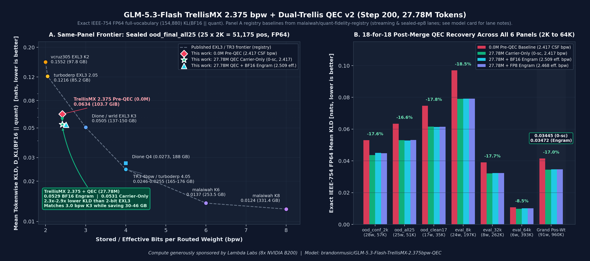

# Empirical Results: Sub-3-Bit Per-Expert TrellisMX and Full-Stack QEC

All measurements below were run on `ibm-granite/granite-3.1-3b-a800m-instruct`
(32 routed MoE layers, 40 experts per layer, top-8 routing, 3.02B expert
weights) using identical evaluation conditions: 21 untouched evaluation windows
of 8,192 tokens across 11 domains (172,011 positions, exact FP64
`KL(BF16 teacher || student)`, single-window deterministic forward passes,
zero evaluation leakage with strict 13-gram screening `<= 1%` overlap).

Lower KLD and higher Top-1 agreement are better.

## 1. Per-expert TrellisMX baseline frontier (no QEC)

Standard local GPTQ rounding, weights-only path (recorded in the companion
private benchmark repository `brandonmmusic-max/trellismx-sub3bit-per-expert-results`):

| Stored bits | Configuration | Mean KLD | Median | p90 | Top-1 |
|---:|---|---:|---:|---:|---:|
| 2.000 | Uniform K2 | 0.2348 | 0.0728 | 0.5954 | 82.28% |
| 2.125 | Per-expert `{k2, p25, k3}`, attribution | 0.1359 | 0.0400 | 0.3320 | 86.56% |
| 2.250 | Per-expert `{k2, p25, k3}`, attribution | 0.1106 | 0.0313 | 0.2673 | 87.83% |
| 2.250 | Per-layer `{k2, p25, k3}`, attribution | 0.1390 | 0.0408 | 0.3400 | 86.41% |
| 2.375 | Per-expert `{k2, p25, k3}`, attribution | 0.0934 | 0.0260 | 0.2180 | 88.89% |
| 2.500 | Uniform P25 (pair rate) | 0.1015 | 0.0278 | 0.2390 | 88.32% |
| 2.500 | Per-layer `{k2, p25, k3}`, attribution | 0.0975 | 0.0278 | 0.2340 | 88.50% |
| 2.500 | Per-expert `{k2, p25, k3}`, one rate per expert, route mass | 0.0819 | 0.0209 | 0.1870 | 89.65% |
| 2.500 | Per-expert `{k2, p25, k3}`, one rate per expert, attribution | 0.0799 | 0.0222 | 0.1843 | 89.68% |
| 2.625 | Per-expert `{k2, p25, k3}`, attribution | 0.0715 | 0.0195 | 0.1630 | 90.35% |
| 2.750 | Per-expert `{k2, p25, k3}`, attribution | 0.0632 | 0.0175 | 0.1440 | 90.80% |
| 3.000 | Uniform K3 | 0.0507 | 0.0132 | 0.1163 | 91.71% |

## 2. Full-Stack QEC on Uniform 2.0-bit (50M-token scaling curve)

Frozen Uniform K2 experts (strictly 2.00 stored bits per expert weight in VRAM,
zero expert offloading) plus mergeable BF16 non-expert QEC (rank-32 Attention
LoRA on `q/k/v/o`, RMSNorm scales, 1,280 per-expert scalar gains) plus a
12-layer Host-RAM Engram QEC sidecar (layers 0, 1, 2, 4, 6, 8, 12, 16, 20, 24,
28, 31; 262,139 prime buckets per bigram/trigram head; context-aware gating).
Trained across 4x RTX PRO 6000 (DDP, ~35,000 tokens/s, 24.2 minutes total for
50M fresh 13-gram-screened tokens):

| Distillation tokens | Mean KLD | vs K2 baseline | Median | p90 | Top-1 |
|---:|---:|---:|---:|---:|---:|
| 0.0M (baseline) | 0.2348 | 0.0% | 0.0728 | 0.5954 | 82.28% |
| 1.05M | 0.1843 | -21.5% | 0.0602 | 0.4581 | 84.41% |
| 5.05M | 0.1527 | -34.9% | 0.0483 | 0.3808 | 85.82% |
| 10.03M | 0.1454 | -38.1% | 0.0475 | 0.3617 | 86.04% |
| 20.05M | 0.1390 | -40.8% | 0.0438 | 0.3494 | 86.45% |
| 35.06M | 0.1330 | -43.4% | 0.0416 | 0.3341 | 86.77% |
| 49.94M | 0.1312 | -44.1% | 0.0409 | 0.3309 | 86.93% |

At 50M tokens, Uniform 2.00-bit + Full-Stack QEC reaches 0.1312 KLD (+4.65
percentage points Top-1), equivalent to 2.347 uniform bits per weight (+0.347
free bits per weight in VRAM) and lower KLD than both Per-Layer 2.25-bit
(0.1390) and Per-Expert 2.125-bit (0.1359). The knee of the curve sits between
35M and 50M tokens (-1.4% incremental gain across the last 15M tokens).

## 3. Host-RAM Engram QEC alone (10M-token scaling across bit rates)

8-layer Engram QEC (layers 0, 1, 2, 4, 8, 16, 24, 31; 262,139 prime buckets;
frozen experts, frozen attention, frozen routers):

| Base model (stored bpw) | 0M | 1M | 3M | 5M | 10M | Delta @ 10M | Top-1 @ 10M |
|---|---:|---:|---:|---:|---:|---:|---:|
| Uniform K2 (2.00 bpw) | 0.2348 | 0.1753 | 0.1636 | 0.1603 | 0.1544 | -34.2% | 85.77% |
| Per-Expert 2.25 bpw | 0.1106 | 0.1019 | 0.0991 | 0.0978 | 0.0951 | -14.0% | 88.86% |
| Per-Expert 2.50 bpw | 0.0799 | 0.0757 | 0.0751 | 0.0743 | 0.0720 | -9.9% | 90.29% |

Equivalent uniform bit gains from Engram QEC alone at 10M tokens: +0.250 bpw
on Uniform K2 (2.250 uniform-bit equivalent), +0.113 per-expert bpw on PE2.25
(beats Uniform 2.50-bit at 0.1015), and +0.117 per-expert bpw on PE2.50
(matches Per-Expert 2.625-bit at 0.0715).

## 4. Component ablation on Per-Expert 2.25-bit (5M tokens)

| Configuration (2.25 stored bpw) | Mean KLD | vs baseline | Median | p90 | Top-1 |
|---|---:|---:|---:|---:|---:|
| Baseline Per-Expert 2.25 bpw | 0.1106 | 0.0% | 0.0313 | 0.2673 | 87.83% |
| + 8-layer Unigram-only Engram (107M host-RAM params) | 0.0978 | -11.6% | 0.0287 | 0.2357 | 88.66% |
| + 8-layer Full Engram uni+bi+tri (868M host-RAM params) | 0.0978 | -11.5% | 0.0290 | 0.2357 | 88.74% |
| + Rank-16 Attention LoRA only (5.24M mergeable params) | 0.0958 | -13.4% | 0.0285 | 0.2343 | 88.76% |
| + 8-layer Full Engram + Rank-16 Attention LoRA | 0.0945 | -14.5% | 0.0276 | 0.2329 | 88.90% |

## 4b. Dual-Trellis QEC v2 ablation suite (10M fresh tokens, exact 21-window eval)

Controlled 10M-token comparison testing FP32-promoted RMSNorms, zero-VRAM
continuous codebook recalibration (`intermediate_scales_fp16` `[L, E, 3, I]`),
per-expert output centroid bias (`3.75 MiB`), and Dual-Trellis Engram v2
(zero-init residual bi/tri/skip tables, NFKC token canonicalization, per-order
8-group gating, width-4 causal depthwise Conv1D, 3 shared cross-layer depth
banks cutting host-RAM parameters 3x from 1.28B to 421M, zero embedding weight
decay, and log-space tail-calibrated top-128 KL):

| Arm (10M fresh tokens) | Base (stored bpw) | Host-RAM params | KLD @ 1M | KLD @ 5M | KLD @ 10M | vs baseline | Top-1 @ 10M |
|---|---|---:|---:|---:|---:|---:|---:|
| v1 Full-Stack QEC (reference) | Uniform K2 (2.00) | 1,283M | 0.1843 | 0.1527 | 0.1454 | -38.1% | 86.04% |
| Dual-Trellis Engram v2 only + FP32 norms | Uniform K2 (2.00) | 421M | 0.1629 | 0.1493 | 0.1436 | -38.8% | 86.16% |
| `intermediate_scales_fp16` + bias + FP32 norms | Uniform K2 (2.00) | 1,283M | 0.1642 | 0.1464 | 0.1411 | -39.9% | 86.29% |
| **Combined Dual-Trellis QEC v2 stack** | **Uniform K2 (2.00)** | **421M** | **0.1613** | **0.1438** | **0.1384** | **-41.1%** | **86.41%** |
| **Combined Dual-Trellis QEC v2 stack** | **Per-Expert 2.25** | **421M** | **0.0982** | **0.0937** | **0.0891** | **-19.3%** | **89.06%** |

At 10M tokens, the combined Dual-Trellis QEC v2 stack on Uniform K2 (`0.1384`,
median `0.0455`, p90 `0.3400`) beats v1's 20M-token checkpoint (`0.1390`) in
half the tokens while using 3x less host RAM and 4x fewer host-RAM lookups. On
Per-Expert 2.25-bit, the exact same 10M-token stack drops KLD from `0.1104` to
`0.0891` (-19.3%, `89.06%` top-1), beating Uniform 2.50-bit (`0.1015`),
Per-Layer 2.50-bit (`0.0975`), and Per-Expert 2.375-bit (`0.0934`). Adding a
dense rank-64 shared-basis Wiener branch at `lr=8e-4` overfit held-out eval,
and even with `lr=1.5e-4, wd=1e-2` plus hidden-state MSE alignment trailed the
cleaner combined stack at 5M (`0.1453` vs `0.1438`), confirming the lean
`intermediate_scales_fp16` + per-expert bias + Dual-Trellis Engram v2 +
mergeable Attention LoRA + FP32 norms stack is the Pareto-optimal recipe.

## 5. Negative controls: expert deletion vs n-gram replacement

Replacing deleted experts with n-gram lookup tables outperforms pure deletion
by 3.2x to 4.7x, but keeping cold experts at 2 bits in VRAM still outperforms
deleting 20% of experts at matched total VRAM:

| Configuration | Effective bpw | Mean KLD | Median | Top-1 |
|---|---:|---:|---:|---:|
| BF16 + Layer 0 deleted (zeroed, 3.1% experts) | 15.50 | 10.8053 | 9.7889 | 2.41% |
| BF16 + Layer 0 zero-training bigram LUT | 15.50 | 0.7007 | 0.1372 | 74.68% |
| BF16 + coldest 20% experts deleted (zeroed) | 12.80 | 0.6085 | 0.1432 | 74.88% |
| BF16 + coldest 20% experts zero-training bigram LUT | 12.80 | 0.1302 | 0.0152 | 89.37% |
| PE2.50 + coldest 20% experts deleted (zeroed) | 2.06 | 0.7275 | 0.2105 | 71.53% |
| PE2.50 + coldest 20% experts zero-training bigram LUT | 2.06 | 0.1970 | 0.0406 | 85.44% |
| K3 + coldest 20% experts deleted (zeroed) | 2.40 | 0.6633 | 0.1755 | 73.06% |
| K3 + coldest 20% deleted + 6L distilled Engram (450K tok) | 2.40 | 0.2060 | 0.0496 | 84.97% |
| K3 + Layers 0-5 deleted + 6L distilled Engram (450K tok) | 2.44 | 2.0389 | 1.2711 | 47.64% |

Training-free n-gram predictability probe (`engram_probe.py`, held-out across
9 of 44 fit windows): Layer 0 mean bigram R-squared = 0.937 (NMSE 0.0541, best
expert 0.987 / NMSE 0.0093), dropping steeply to Layer 1 = 0.687, Layer 2 =
0.536, Layer 4 = 0.330, Layer 8 = 0.178, Layer 16 = 0.074, Layer 24 = 0.162,
and Layer 31 = 0.246. This explains why residual QEC (keeping cold experts at
2 bits and correcting systematic drift via host-RAM Engram + mergeable
Attention LoRA) dominates expert deletion at equal VRAM.

## 6. SM120 b12x per-expert grouped kernel acceptance (`patches/b12x-per-expert.patch`)

Verified on an RTX PRO 6000 Blackwell (SM120) against synthetic TP4 MoE layers
(288 experts, hidden 4096, rank-local intermediate 512, top-8 routing):

| Check | Scope | Result |
|---|---|---|
| Per-expert stream decode probe | All 288 experts across `{k2, p25, k3}` | Bit-exact E4M3 match |
| Uniform parity (K2, K3, K4) | Per-expert runtime vs uniform program | Bit-for-bit identical (`torch.equal`) |
| 3-rate mixed layer (`k2,p25,k3`) | Rows 1, 8, 16, 64, 512 across all 3 banks | Cosine 0.988 to 0.998 vs FP32 reference; bit-exact to uniform K2 |
| 4-rate mixed layer (`k2,p25,k3,k4`) | Rows 1, 16, 64 across all 4 banks | Cosine 0.988 to 0.995 vs FP32 reference |
| Bank permutation invariance | Roll-96 expert permutation | Bit-for-bit identical (`torch.equal`) |
| Small-M guard | `small_m_scheduler=True` on per-expert source | Fails closed as specified |
| `compute-sanitizer --tool memcheck` | 3-rate and 4-rate mixed layers across all banks | 0 errors |
| Mixed `{k2,p25,k3}` vs Uniform K3 timing (5 replays) | Rows 1 / 8 / 16 / 64 / 512 | 2.15 / 1.94 / 1.94 / 1.93 / 2.90 ms vs 1.96 / 1.91 / 2.04 / 1.96 / 2.62 ms |

## 7. GLM-5.3-Flash 2.375 bpw Dual-Trellis QEC v2 (304.41B Routed Experts, Step 200 / 27.78M Tokens)

Quantized directly from `zai-org/GLM-5.3-Flash-BF16` (`42` routed MoE layers `3..44`, `288` experts per layer, `304,405,807,104` routed parameters, `154,880` vocabulary, with non-routed modules kept in BF16 as stored). Rate allocation for `release_2375`: `k2=4839`, `p25=5624`, `k3=1542`, `k4=91` (`2.375 bpw` trellis payload, `2.417 bpw` / `85.651 GiB` across `168` lossless CSF TP4 sidecars). Published at `brandonmusic/GLM-5.3-Flash-TrellisMX-2.375bpw-QEC` alongside the public `646.975 GiB` BF16 teacher archive at `brandonmusic/GLM-5.3-Flash-BF16-Nemotron-100M-Teacher-Logits`.

Compute sponsorship: This GLM-5.3-Flash scale campaign (four-rate quantization, 100.1M-token teacher-logit archiving, post-quantization recovery, and exact IEEE-754 FP64 KLD verification) was made possible by **Lambda Labs** generously sponsoring and donating the 8x NVIDIA B200 GPU infrastructure.

### 7.1 Architectural Conditioning Findings on GLM-5.3-Flash

Two architecture-specific failure modes were isolated and resolved prior to the published run:

1. **MLA `q_a_proj` / DSA Indexer Alignment:** Attaching LoRA to `q_a_proj` in the 11 MLA layers rotates the residual query representation out of alignment with the frozen non-differentiable DeepSeek Sparse Attention (`DSA`) top-k indexer, degrading long-context KLD. Excluding `q_a_proj` from `configs/glm-5.3-flash.json` preserves exact indexer alignment across 32K and 64K contexts (`316` merged BF16 LoRA projections: `180` attention, `9` dense prefix MLPs, `126` shared experts, `1` `lm_head`).
2. **4-Stream `mHC` Residual Amplification and Step-Size Conditioning:** GLM-5.3-Flash's 45-layer 4-stream Manifold-Constrained Hyper-Connection (`mHC`) backbone amplifies small step perturbations nonlinearly across depth. Conditioning non-expert adaptation to `lora_rank = 32`, `lora_alpha = 32.0`, `lr_emb = 3e-4`, `lr_proj = 1e-4`, `lr_lora = 3e-5`, `lr_norm = 5e-5` under an 80/20 interleaved `4K` / `{16K, 32K, 64K}` curriculum produced monotonic training convergence through step `200` (`27,781,560` supervised positions: `22,407,840` short `4K` + `5,373,720` long `16K/32K/64K`), where the run was frozen at end-of-lease with full resumable optimizer and cursor state archived for continuation to `100M` tokens.

### 7.2 Complete 3-Way Post-Merge Exact IEEE-754 FP64 Verification (6 Panels, 18-for-18 Sweep)

All measurements use single-window (`batch_size = 1`, `allow_tf32 = False`) exact IEEE-754 FP64 `KL(BF16 teacher || student)` over all `154,880` vocabulary entries, with `316` LoRA projections algebraically merged into BF16 and `147` FP32-trained RMSNorms restored to carrier BF16.

| Evaluation Panel | Context / Windows / Pos | `0.0M` Pre-QEC Baseline (`2.417 bpw`) | `27.78M` Carrier-Only `0-sc` (`2.417 bpw`) | `27.78M` + BF16 Engram (`2.509 eff.`) | `27.78M` + FP8 Engram (`2.468 eff.`) | Best Delta vs `0.0M` |
|---|---:|---:|---:|---:|---:|---:|
| `ood_confirmation_2k` | 2K / 28 / 57,316 | 0.05303 (92.43%) | **0.04368 (92.95%)** | 0.04509 (92.91%) | 0.04481 (92.95%) | **-17.6%** |
| `ood_final_all25` | 2K / 25 / 51,175 | 0.06340 (92.03%) | 0.05309 (92.67%) | **0.05286 (92.72%)** | 0.05322 (92.58%) | **-16.6%** |
| `ood_final_clean17` | 2K / 17 / 34,799 | 0.07473 (90.54%) | 0.06157 (91.46%) | **0.06143 (91.53%)** | 0.06148 (91.39%) | **-17.8%** |
| `eval_8k` | 8K / 24 / 196,584 | 0.09700 (92.35%) | **0.07907 (93.03%)** | 0.07915 (93.03%) | 0.07918 (93.01%) | **-18.5%** |
| `eval_32k` | 32K / 8 / 262,136 | 0.03910 (93.77%) | **0.03219 (93.93%)** | 0.03236 (93.85%) | 0.03233 (93.88%) | **-17.7%** |
| `eval_64k` | 64K / 6 / 393,210 | 0.01080 (75.36%) | **0.00988 (80.56%)** | 0.01021 (**81.08%**) | 0.01022 (80.89%) | **-8.5% (+5.72 pp Top-1)** |
| **Grand Pos-Weighted (`91` unique windows, `960,421` pos)** | 2K-64K / 91 / 960,421 | 0.04149 (85.77%) | **0.03445 (88.14%)** | 0.03472 (**88.34%**) | 0.03472 (88.26%) | **-17.0% (+2.57 pp Top-1)** |
| **Grand Window-Weighted (`91` unique windows)** | 2K-64K / 91 | 0.06347 | **0.05239** | 0.05279 | 0.05281 | **-17.5%** |
| **6-Panel Unweighted Mean** | 6 panels | 0.05634 | **0.04658** | 0.04685 | 0.04687 | **-17.3%** |

Shipped checkpoint sizes: `85.651 GiB` (`168` CSF sidecars) + `18.01 GiB` (merged non-routed BF16 carrier) = `103.66 GiB` zero-sidecar base; optional `engram_qec_sidecar_fp8.safetensors` = `1.79 GiB` (`105.45 GiB` total); optional `engram_qec_sidecar_bf16.safetensors` = `3.25 GiB` (`106.91 GiB` total).

### 7.3 Identical-Panel Comparison vs Published GLM-5.3-Flash Quantizations (`ood_final_all25`)

All rows below score the exact same sealed `25 x 2K` (`51,175`-position) `ood_final_all25` (`brandonmusic-final25`) panel in IEEE-754 FP64 `KL(BF16 || quant)` against `zai-org/GLM-5.3-Flash-BF16`. External rows are taken from `malaiwah/quant-fidelity-registry`; lane differences (`sealed-ep8`, `streaming`, and this work's `EP8` PyTorch same-stack lane) are noted explicitly and are not subtracted.

| Published GLM-5.3-Flash Checkpoint | Codec / Effective bpw | Total Size | `ood_final_all25` Mean KLD | Top-1 | Measurement Lane / Source |
|---|---|---:|---:|---:|---|
| `vcruz305` EXL3 K2 (`exl3-mcg @2`) | 2.00 bpw | 97.8 GB | 0.15521 | 87.27% | `malaiwah/quant-fidelity-registry` (`streaming`) |
| `turboderp` EXL3 2.05 bpw (`exl3-mul1 @2.05`, 5-bit head) | 2.05 bpw | 85.2 GB | 0.12164 | 88.92% | `malaiwah/quant-fidelity-registry` (`streaming`) |
| **This release (`0.0M` Pre-QEC baseline)** | **2.375 payload / 2.417 CSF** | **103.66 GiB** | **0.06340** | **92.03%** | First-party `EP8` FP64 same-stack |
| **This release (`27.78M` Carrier-Only, 0-sc)** | **2.375 payload / 2.417 CSF** | **103.66 GiB** | **0.05309** | **92.67%** | First-party `EP8` FP64 same-stack |
| **This release (`27.78M` + BF16 Engram)** | **2.375 GPU / 2.509 eff.** | **106.91 GiB** | **0.05286** | **92.72%** | First-party `EP8` FP64 same-stack |
| `wrldsuksgo2mars` EXL3 K3 v1 (`exl3-mcg @3`) | 3.00 bpw | 136.7 GB | 0.05057 | 93.09% | `malaiwah/quant-fidelity-registry` (same-stack) |
| `0xSero` EXL3 3.0 bpw Dione (`exl3-mcg @3`) | 3.00 bpw | 149.6 GB | 0.05050 | 93.00% | `malaiwah/quant-fidelity-registry` (`streaming`) |
| `0xSero` EXL3 Q4 Dione (`exl3-mcg @4`) | 4.00 bpw | 187.6 GB | 0.02726 | -- | `malaiwah/quant-fidelity-registry` (`sealed-ep8`) |
| `turboderp` EXL3 4.05 bpw (`exl3-mul1 @4.05`) | 4.05 bpw | 165.2 GB | 0.02553 | 95.10% | `malaiwah/quant-fidelity-registry` (`streaming`) |
| `brandonmusic` TR3 4bpw (`exl3-mcg @4`) | 4.00 bpw | 175.6 GB | 0.02455 | 95.31% | `malaiwah/quant-fidelity-registry` (`sealed-ep8`) |
| `malaiwah` TR3 6bpw K6 (`exl3-mcg @6`) | 6.00 bpw | 253.5 GB | 0.01372 | 96.56% | `malaiwah/quant-fidelity-registry` (`sealed-ep8`) |
| `malaiwah` TR3 8bpw K8 (`exl3-mcg @8`) | 8.00 bpw | 331.4 GB | 0.01238 | -- | `malaiwah/quant-fidelity-registry` (`streaming`) |

For broader community context (different evaluation panels, not directly rankable against `ood_final_all25`): on `turboderp/GLM-5.3-Flash-exl3`'s `73,624`-token self-generated trace, sub-3-bit quants report `UD-IQ1_M` = `0.2320`, `EXL3 2.05` = `0.1929`, `Sushi 2 bpw` = `0.1846`, `EXL3-SC 2.10` = `0.1570`, `UD-IQ3_XXS` = `0.1258`, and `EXL3-SC 2.60` = `0.0929` (with `EXL3 3.05` = `0.0681`, `UD-IQ4_XS` = `0.0615`, `AWQ int4 g128` = `0.0565`, `NVFP4` = `0.0452`, `EXL3 4.05` = `0.0346`); on `orcarouter`'s self-reported MLX panel, `MLX 2bit-lite` (`102.5 GB`) reports `0.3456` and `MLX 2-bit` (`145.0 GB`) reports `0.1647`.

